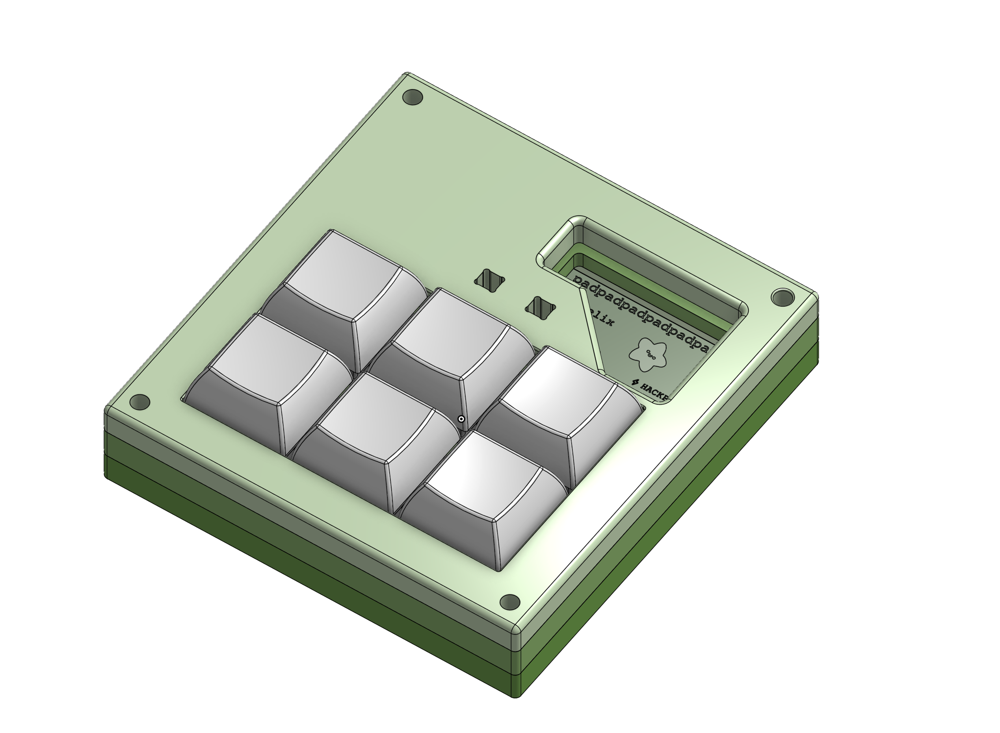
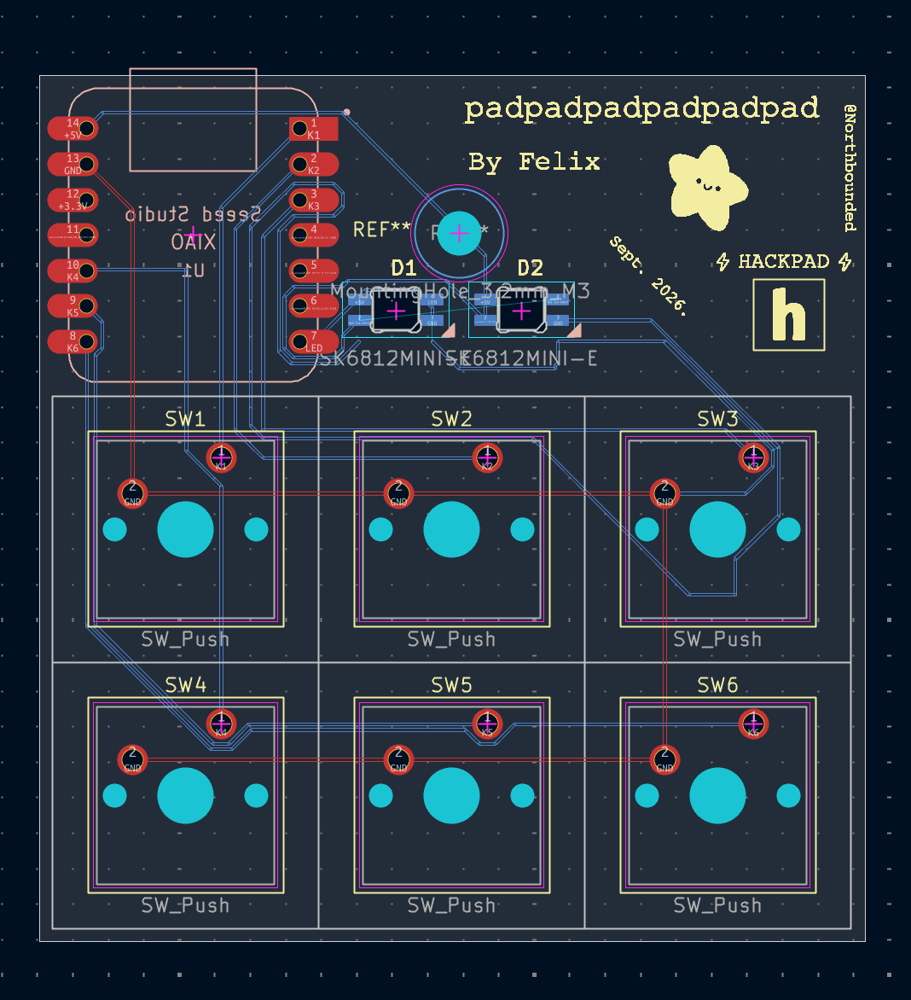
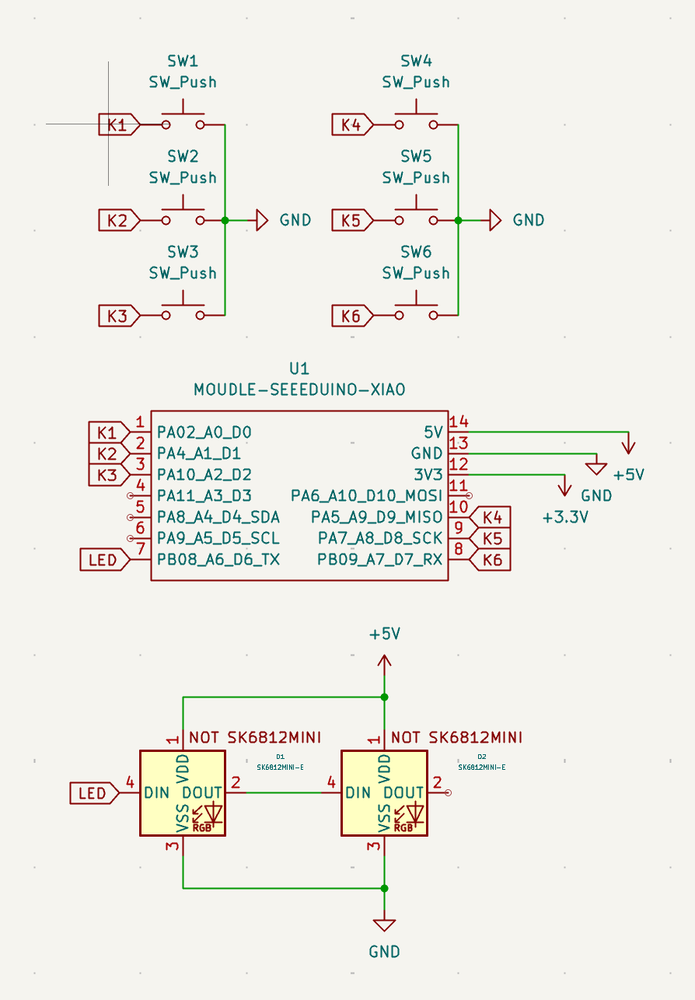

# padpadpadpadpadpad

Padpadpadpadpadpad (or pad^6) is a simple hackpad with 6 keys and 2 WS2812B LEDs. Made for fun + learning experience

## Features
- 6 mechanical keys
- 2 WS2812B LEDs
- A 3D printed case made of 3 parts
- QMK Firmware

## CAD
The case is made of 3 parts (e.g. top plate, middle, bottom).

Made in Onshape

## PCB
The PCB was designed in KiCad. 

I found the silkscreen on the internet.

Schematic:

## Firmware
This hackpad uses QMK Software for everything.
[https://qmk.fm/](url)

## BOM

Here's everything you need to make this hackpad:
- 1 XIAO RP2040
- 6 Cherry MX Switches
- 6 DSA Keycaps
- 2 SK6812 MINI-E LEDS
- 1 Case (3 3D printed parts)
- Custom PCB
- 4 M3x16mm screws
- 4 M3x5mx4mm heatset insert
